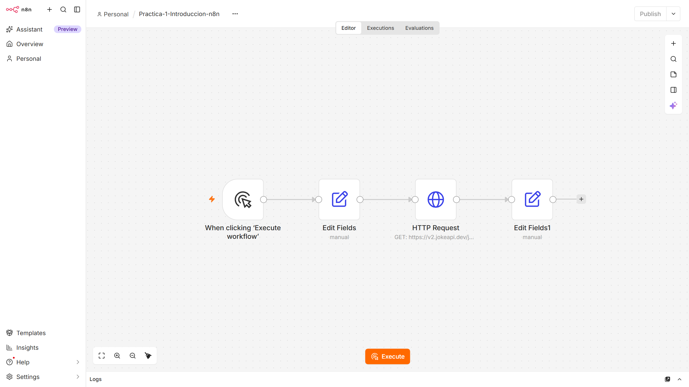
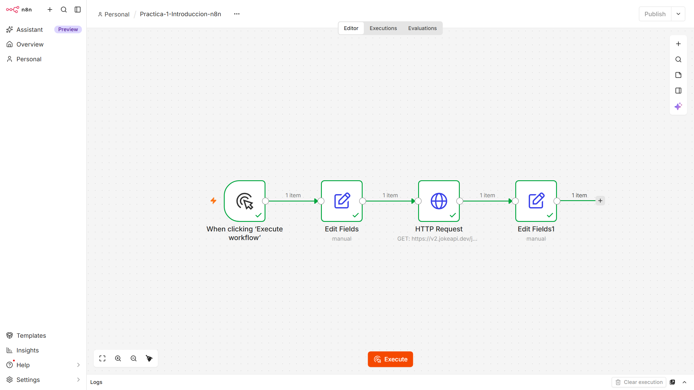
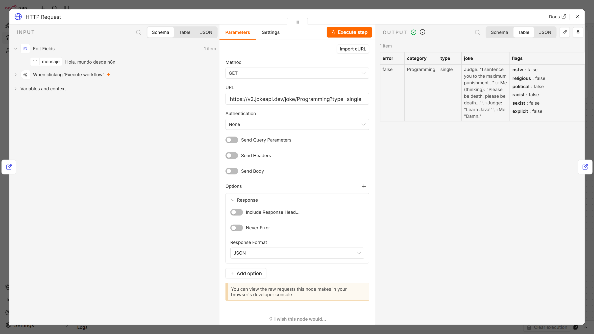

# Práctica 1 — Introducción a n8n

**Asignatura:** Integración de Tecnologías y Servicios Informáticos (ITSI)
**Alumno:** Roberto Castillo — rct419@inlumine.ual.es

Primer workflow en n8n que genera un mensaje, consulta una API pública de chistes de programación y extrae los campos relevantes de la respuesta.

---

## Cómo importar y ejecutar el workflow

1. Abrir su propia instancia de n8n en el navegador (por defecto, en local: http://localhost:5678).
2. **Create workflow → menú `…` → Import from File** y seleccionar [`workflows/Practica-1-Introduccion-n8n.json`](workflows/Practica-1-Introduccion-n8n.json).
3. Pulsar **Execute workflow**.

El workflow no necesita credenciales: la API utilizada es pública.

## 1. Workflow `Practica-1-Introduccion-n8n`



| # | Nodo | Tipo | Función |
|---|---|---|---|
| 1 | When clicking 'Execute workflow' | Manual Trigger | Inicia el workflow manualmente |
| 2 | Edit Fields | Set | Crea el campo `mensaje = "Hola, mundo desde n8n"` |
| 3 | HTTP Request | HTTP Request | `GET https://v2.jokeapi.dev/joke/Programming?type=single` |
| 4 | Edit Fields1 | Set | Extrae `broma`, `categoria` e `identificador` de la respuesta |

El workflow exportado está en [`workflows/Practica-1-Introduccion-n8n.json`](workflows/Practica-1-Introduccion-n8n.json).

## 2. Ejecución

Resultado de una ejecución (`status: success`). La API devuelve un chiste aleatorio, por lo que el contenido cambia en cada ejecución:

```json
{
  "broma": "A byte walks into a bar looking miserable.\nThe bartender asks it: \"What's wrong buddy?\"\n\"Parity error.\" it replies. \n\"Ah that makes sense, I thought you looked a bit off.\"",
  "categoria": "Programming",
  "identificador": 25
}
```




